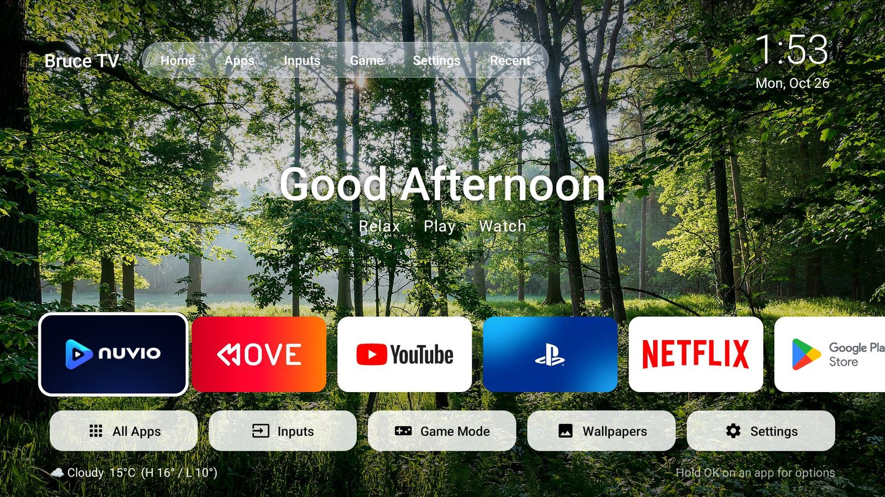
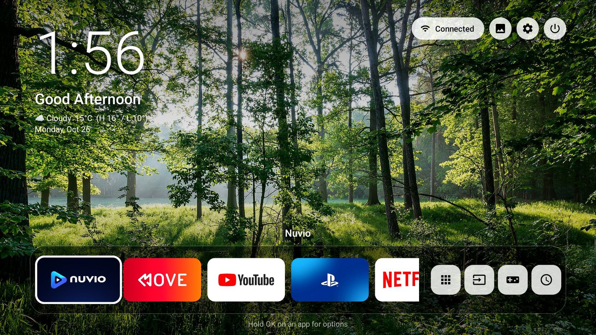
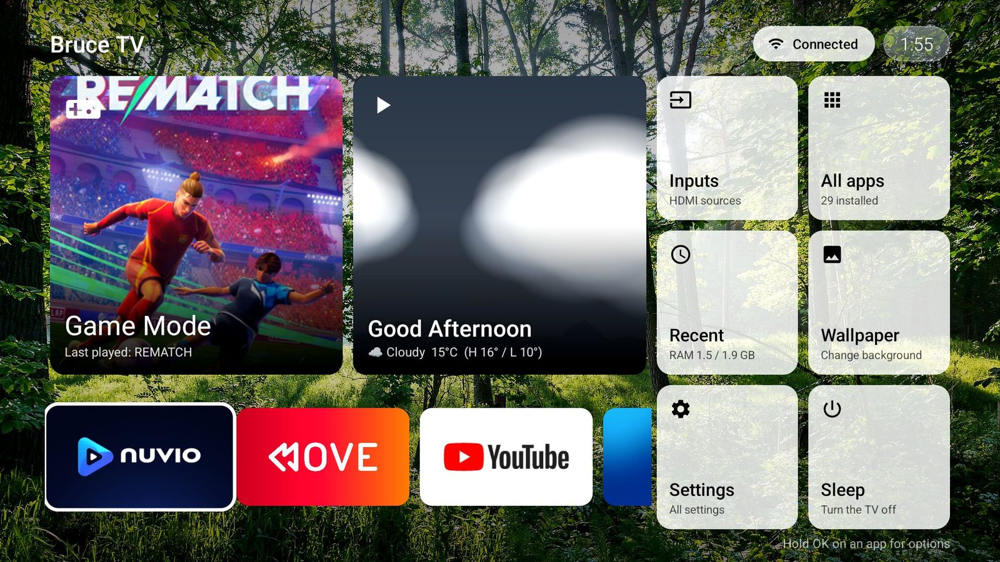
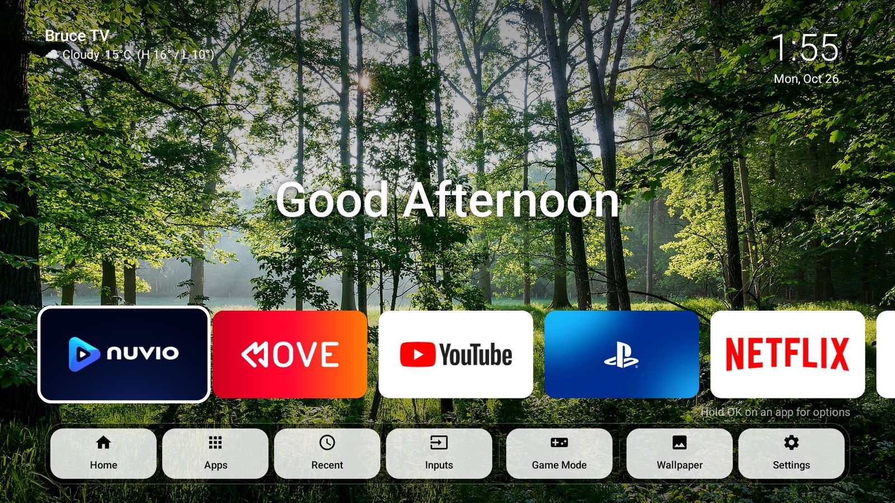
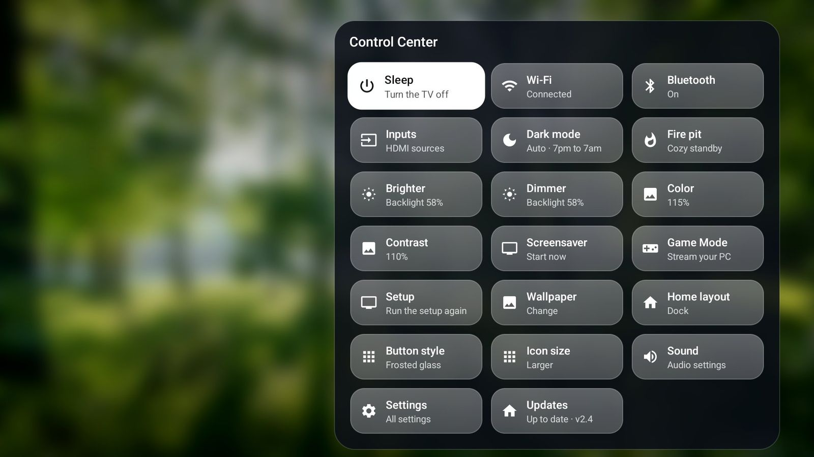
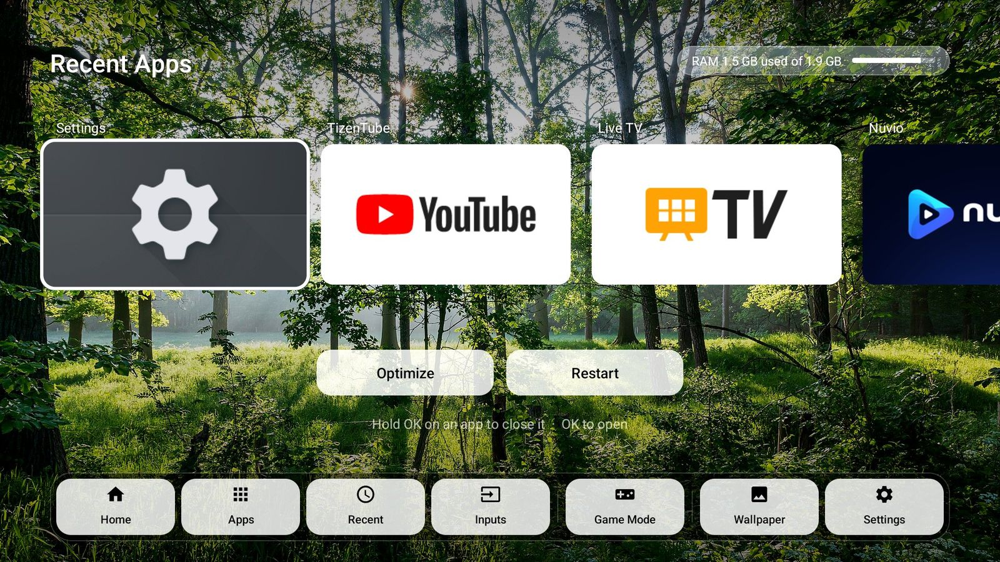
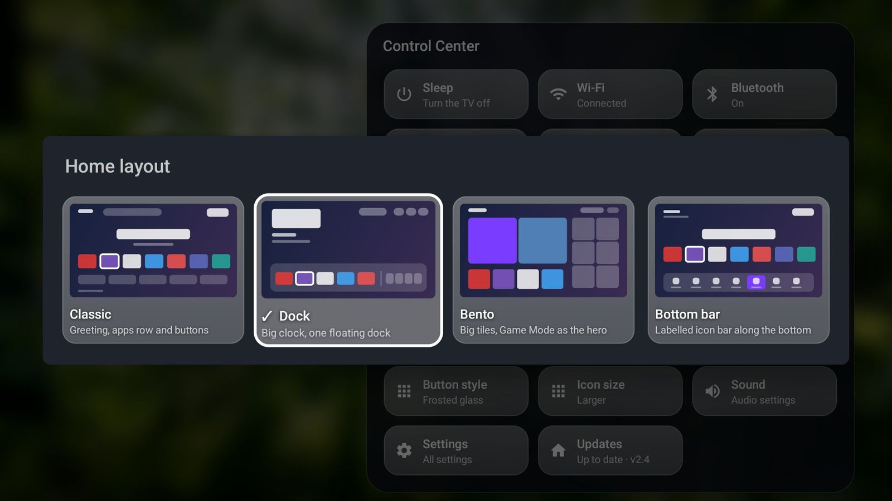

<div align="center">

# Bruce TV

**A fast, good-looking home screen for Google TV, with a console-style Game Mode that streams your gaming PC.**

Plain Java · zero dependencies · 230 KB · Android 9+ (built and tested on Android 14)

[**Download the latest APK**](https://github.com/martintenovski/BruceTV/releases/latest) · [Website](https://martintenovski.github.io/BruceTV/) · [Quick start](#quick-start)



</div>

> Formerly **Luna TV** (and before that, Bearacle TV). The package id is still `com.bearacle.tv`, so updating from an older build keeps your settings.

## What it is

Stock Google TV home is mostly ads and a recommendations feed, and it forces its own layout. Bruce TV replaces it with a launcher that is yours: your apps first, a layout you pick, quick controls one button away, and your gaming PC one tile away.

**Two parts, and you can use just the first:**

| Part | What it does | Needs |
|---|---|---|
| **The launcher** (`app/`) | The home screen, Control Center, Recent apps, wallpapers, updates | Just the TV |
| **Game Mode** (`pc/`) | A console-style menu of your PC's games, streamed to the TV | A Windows gaming PC ([Step 1](#step-1-get-your-gaming-pc-ready-only-for-game-mode)) |

## Screenshots

| Classic | Dock |
|---|---|
|  |  |
| **Bento** (Game Mode shows the cover of your last played game) | **Bottom bar** |
|  |  |
| **Control Center** | **Recent apps** |
|  |  |

<details>
<summary>Picking a layout</summary>

</details>

## Features

- **Four home layouts**: Classic, Dock, Bento, Bottom bar. Switch any time in Control Center › Home layout.
- **A Home button that works**: Google TV normally forces its own home. Bruce TV's accessibility service puts the launcher back on top.
- **Control Center**: backlight brightness, launcher Color and Contrast, Wi-Fi, Bluetooth, inputs, dark mode, sleep, wallpaper, button style, icon size, a Fire pit standby (loops a video of your own) and updates.
- **Recent apps**: see what is running and how much RAM is free, close apps, optimize memory or restart the TV.
- **Rearrange Home**: open an app's menu (hold OK) › *Move on Home*, then use the d-pad.
- **Weather and wallpaper**: a live weather scene, a daily photo or your own images.
- **Game Mode**: your PC's Steam, Epic, Microsoft Store (Xbox), GOG and Ubisoft games with cover art, streamed through Moonlight. Controller profiles for a DualShock 4 included.
- **Self-updating**: Control Center › Updates reads this repo's releases, shows what's new, then installs.

## Quick start

You do three things, in this order. **Step 1 is only needed for Game Mode**: if you just want the launcher, skip to Step 2.

### Step 1: Get your gaming PC ready (only for Game Mode)

Do this **before** the TV setup, because the TV's setup wizard looks for the PC and pairs with it.

What you need on the PC:

- A **Windows 10/11 gaming PC** that is on and on the **same home network as the TV** (wired is best for streaming).
- **[Apollo](https://github.com/ClassicOldSong/Apollo/releases)**, the streaming host. Install it and let it finish. (It is a fork of Sunshine that Moonlight talks to.)
- **Python 3.10 or newer**. If you don't have it, the setup script offers to install it for you.
- Your games in a launcher: Steam, Epic, Microsoft Store, GOG or Ubisoft. Any other game can be added by hand later.

Then run the PC setup once:

1. Download this repo (**Code › Download ZIP**, then extract it) and put the folder somewhere permanent, for example `C:\BruceTV`. **Don't move it afterwards**: the PC helper points at it.
2. Open the `pc` folder, right-click **`setup.ps1`** › **Run with PowerShell**, and accept the one administrator prompt.

It finds Python, adds **"Game Mode"** to Apollo's app list, opens the firewall for your home network only (ports 8765 and 8766), and starts a small helper at every logon so the TV can find the PC and read your game list. If Apollo or Python is missing it tells you what to install, then run it again. It is safe to run as many times as you like.

Optional: install **DS4Windows** first if you use a DualShock 4, and the script sets up controller control for it too.

### Step 2: Install Bruce TV on the TV

Pick whichever is easier for you.

#### Option A: from your phone (no PC needed)

1. On your phone, open the [latest release](https://github.com/martintenovski/BruceTV/releases/latest) and download **`bruce-tv-<version>.apk`**.
2. Send it to the TV with any file-transfer app (for example **Send Files to TV**, installed on both the phone and the TV). A USB stick works too.
3. On the TV, open the file in a file manager (for example *Files by Google* or *X-plore*) and choose **Install**. If it says installs from this app are blocked, allow it for that file manager and go back.
4. Open **Bruce TV**. The [setup wizard](#step-3-follow-the-setup-wizard-on-the-tv) starts.
5. Turn on the extras (each takes a few clicks, and Bruce TV opens the right screen when it needs one):
   - **Home button:** Settings › Accessibility › **Bruce TV Home button** › On. This also enables Sleep and Restart in Control Center.
   - **Brightness controls:** when Control Center asks, allow Bruce TV to *modify system settings*.
   - **Recent apps:** Settings › Apps › Special app access › **Usage access** › Bruce TV › Allow. (If your TV doesn't list it, use Option B, which sets it for you.)

#### Option B: from your PC (one command, sets everything up)

**On the TV**, turn on wireless debugging (once):

1. Settings › System › About, then press OK on **Build** (or *Android TV OS build*) seven times to unlock Developer options.
2. Settings › System › Developer options › turn on **Wireless debugging**. Note the **IP address and port** shown there. (The port changes after the TV restarts.)
3. First time only: choose **Pair device with pairing code**. It shows a pairing IP:port and a 6-digit code.

**On your PC**, open PowerShell in the folder you extracted and run:

```powershell
winget install Google.PlatformTools                  # once; then open a new PowerShell window
adb pair <pairing-ip:pairing-port> <6-digit-code>    # first time only
.\install-tv.ps1 -Tv <ip:port>                       # the address from Wireless debugging
```

`install-tv.ps1` downloads the latest release, installs it, grants all the permissions, turns on the **Bruce TV Home button** accessibility service, makes it your home screen and starts it. Run it again any time to update.

<details>
<summary>Option B by hand, or on Mac/Linux</summary>

Download `bruce-tv-<version>.apk` from the [latest release](https://github.com/martintenovski/BruceTV/releases/latest), then:

```bash
adb connect <tv-ip>:<port>
adb install -r bruce-tv-<version>.apk
adb shell appops set com.bearacle.tv GET_USAGE_STATS allow
adb shell appops set com.bearacle.tv WRITE_SETTINGS allow
adb shell appops set com.bearacle.tv REQUEST_INSTALL_PACKAGES allow
adb shell pm grant com.bearacle.tv android.permission.READ_MEDIA_IMAGES
adb shell cmd package set-home-activity com.bearacle.tv/.MainActivity
adb shell settings put secure enabled_accessibility_services com.bearacle.tv/.KeyService
adb shell settings put secure accessibility_enabled 1
```

(The `enabled_accessibility_services` line replaces the list; if you use other accessibility services, turn on *Bruce TV Home button* in Settings › Accessibility instead.)
</details>

### Step 3: Follow the setup wizard on the TV

The first time Bruce TV opens (either option), a **setup wizard** guides you through the rest. It takes about a minute, and you can run it again any time from Control Center › **Setup**.

1. **Pick your home screen**: Classic, Dock, Bento or Bottom bar.
2. **Game Mode**: choose *Set up Game Mode*, or *Not now* to finish with just the launcher.
3. **Install Moonlight**: the free streaming app. The wizard opens the Play Store for you.
4. **Find your gaming PC**: the TV scans your network for the PC you prepared in Step 1. If it can't find it, make sure the PC is on and run `pc\setup.ps1` again, or type the PC's address by hand.
5. **Pair Moonlight with the PC**: Moonlight shows a PIN; on the PC open `https://localhost:47990` (Apollo's page), go to **PIN** and type it in.
6. **Your games**: the wizard shows how many games it found.

Then press the **Game Mode** tile and play.

## Game Mode

Start it from the Game Mode tile, the Game button, or the Game Mode app. Press Menu › **Settings** inside it:

- **Scan for games**: re-reads Steam, Epic, Microsoft Store, GOG and Ubisoft, and looks through Games folders on every disk. New finds come up as a list to tick.
- **Add a game**: browse the PC's disks with the remote (or search by name), pick the game's folder or `.exe`, and name it.
- **Manage games**: hide a game, or remove one you added.
- **Game folders**: extra folders the scan looks through.
- **Controllers & button map**: per-controller profiles (DualShock 4 light bar and mapping through DS4Windows).

## Troubleshooting

| Problem | Fix |
|---|---|
| `adb` can't connect | Wireless debugging must be on, and the port changes after a TV restart. Re-read the IP:port on the TV. If it still refuses, pair again. |
| The wizard can't find the PC | PC on and awake? Same network (not a guest Wi-Fi)? Run `pc\setup.ps1` again, then *Scan again*. Or *Type its address*. |
| Moonlight doesn't list the PC | Add it by IP address inside Moonlight. |
| Game Mode can't find its app in Moonlight | Open Moonlight once so it refreshes its app list, then try again. |
| Home button opens the stock Google TV home | Turn on **Bruce TV Home button** in Settings › Accessibility. |

## Updates

Control Center › **Updates** checks this repo's [releases](https://github.com/martintenovski/BruceTV/releases), shows what's new, then downloads and installs. Home also checks every 6 hours and shows a "What's new" note once per version.

## Build from source

Needs JDK 17+, the Android SDK and Gradle 8.14. From PowerShell:

```powershell
.\build.ps1 -NoInstall             # build only
.\build.ps1 -Tv <ip:port>          # build, install, set as home, grant permissions
```

To publish a release (also what the TV updates from):

```powershell
.\release.ps1 -Version 2.5 -NotesFile release-notes\2.5.md
```

It bumps the version in `app/build.gradle`, builds, and creates the GitHub release. Updates must be signed with the same key as the installed app (the debug keystore in `~/.android`), so keep it safe.

## Repo layout

| Path | What's there |
|---|---|
| `app/` | The launcher (plain Java, no libraries) |
| `pc/` | Game Mode for the gaming PC (`setup.ps1` sets it up) |
| `install-tv.ps1` | One-command installer for the TV |
| `docs/` | The website (GitHub Pages) and its images |
| `release-notes/` | The "What's new" text shown on the TV |
| `mockups/` | Early layout mockups (older name) |

## Credits

Game Mode streams with [Moonlight](https://moonlight-stream.org/) and [Apollo](https://github.com/ClassicOldSong/Apollo). Bruce TV is not affiliated with Google; Google TV is a trademark of Google LLC.
